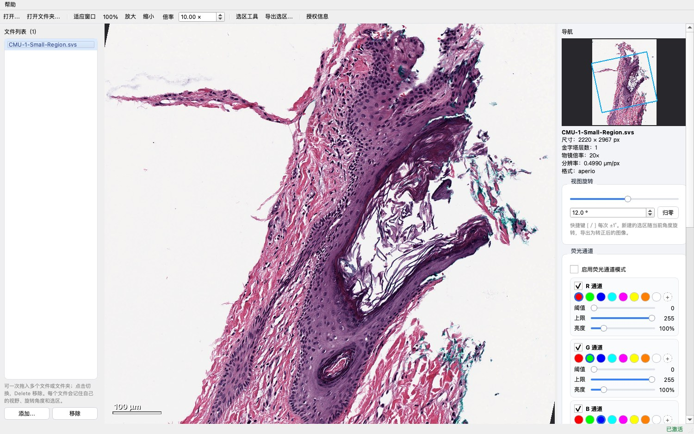
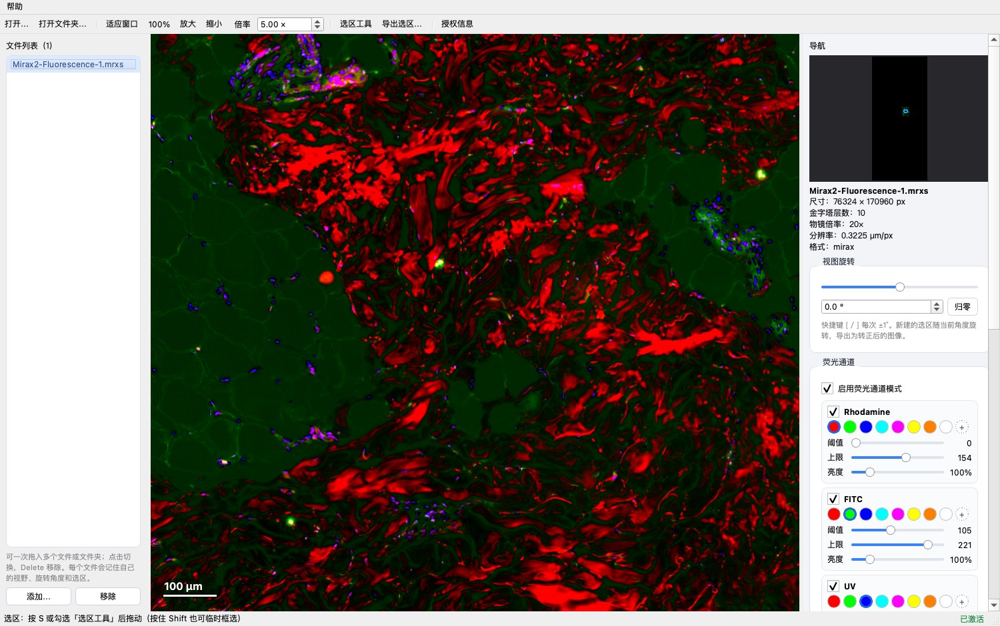
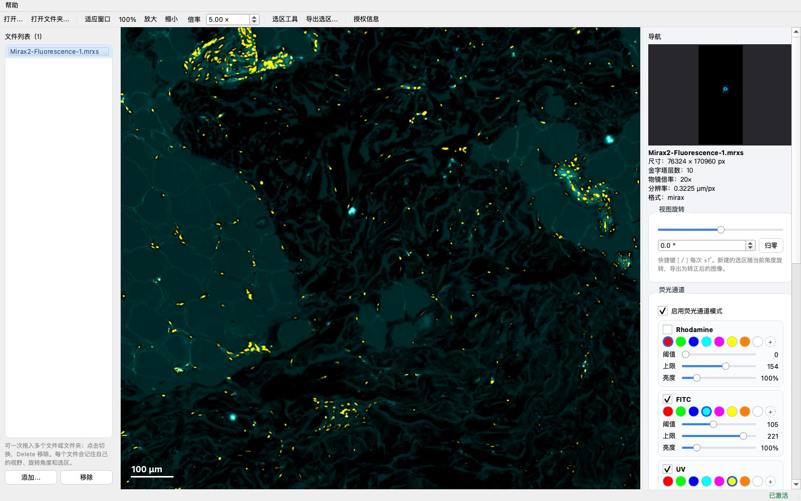

# 切片查看器 SliceViewer

> 一个轻量的**全切片图像（WSI）查看器**：打开数字病理 / 荧光切片，流畅浏览、旋转、调色、框选并导出高清图。
> 支持 **MRXS（3DHISTECH）、SVS（Aperio）、NDPI（Hamamatsu）、SCN、TIFF** 等常见格式，支持 **macOS（Apple 芯片）** 与 **Windows**。

## ⬇️ 下载

| 系统 | 下载 | 说明 |
|---|---|---|
| **Windows 10 / 11（64 位）** | [**SliceViewer-Windows.exe**](https://github.com/Cy0109cY/SliceViewer/raw/main/downloads/SliceViewer-Windows.exe) | 单文件，下载后**双击即可运行**，无需安装 |
| **macOS（Apple 芯片 M1/M2/M3/M4）** | [**SliceViewer-macOS-AppleSilicon.zip**](https://github.com/Cy0109cY/SliceViewer/raw/main/downloads/SliceViewer-macOS-AppleSilicon.zip) | 解压后得到「切片查看器.app」，拖到「应用程序」即可 |

> 首次打开的提示（软件未经商业代码签名，属正常现象）：
> - **Windows**：若出现 SmartScreen「已保护你的电脑」，点「**更多信息 → 仍要运行**」。
> - **macOS**：若提示「已损坏」或「无法验证开发者」，请**右键点击 App → 打开**；或在终端执行：
>   `xattr -cr /Applications/切片查看器.app`
> - 暂不支持 Intel 芯片的 Mac。

## ✨ 功能

- **流畅浏览**：金字塔分层 + 瓦片缓存，超大切片（数十万像素）也能快速缩放、平移；导航缩略图一键跳转
- **倍率可输入**：工具栏直接输入倍率（如 20×），也可 100% 原始像素查看，带比例尺
- **任意角度旋转**：滑块 / 数值 / 快捷键调整视图角度
- **多文件管理**：一次拖入多个文件或整个文件夹，左侧文件列表切换，每个文件独立记忆视野、旋转与调色
- **选区导出**：框选任意（可旋转）区域，固定选区大小，导出 PNG / JPEG / BigTIFF，可选分辨率比例、加比例尺，大区域流式写入不爆内存
- **色彩调整**：Gamma、亮度、对比度、饱和度、色相、色温、色调，以及整体 R / G / B；一键应用到所有切片
- **荧光多通道**：自动识别荧光通道（DAPI / FITC / Cy3 …），每个通道可单独**显示 / 隐藏、换伪彩色（红绿蓝青品红黄橙白或自定义）、调阈值、上限与亮度**
- **MRXS 数据文件夹直接打开**：只有 `Slidedat.ini + Data*.dat` 文件夹、缺少 `.mrxs` 也能打开

### 荧光切片示例
荧光通道逐个上色合成；每个通道可单独调整：

隐藏红色通道、把 FITC 改成青色、UV 改成黄色：

> 示例切片来自 [OpenSlide 公开测试数据](https://openslide.cs.cmu.edu/download/openslide-testdata/)：H&E 为 `Aperio/CMU-1-Small-Region.svs`（CC0 公共领域）；荧光为 `Mirax/Mirax2-Fluorescence-1`（Yves Sucaet 提供，可自由分发）。

## 🆓 免费与 🔒 付费

| | 未激活（免费） | 已激活 |
|---|---|---|
| 打开 / 拖入 / 多文件 / 缩放 / 平移 / 倍率 | ✅ | ✅ |
| 视图旋转 | ✅ | ✅ |
| 选区与导出（PNG / JPEG / TIFF） | 🔒 | ✅ |
| 色彩调整（Gamma / 色相 / 色温 / RGB…） | 🔒 | ✅ |
| 荧光通道（分通道上色与调节） | 🔒 | ✅ |

## 🛒 购买与激活

1. 前往爱发电购买：**[https://afdian.com/item/62d949c4e29e11f18d9552540025c377](https://afdian.com/item/62d949c4e29e11f18d9552540025c377)**
2. 付款后在爱发电「我的订单」里复制**订单号**
3. 打开软件 →「帮助 → 激活 / 授权…」（或工具栏「激活…」）→ 粘贴订单号 → 点「激活」
4. 联网激活一次，之后**离线可用**

说明：一个订单可激活 **1 台电脑**；换电脑前在原电脑点「解绑本机」，再到新电脑用同一订单号激活（解绑次数有限）。刚付款若提示「未找到订单」，请等一两分钟再试。

## 🧪 支持的格式
MRXS、SVS、NDPI、SCN、VMS/VMU、BIF、TIF/TIFF（金字塔）、SVSlide 等 OpenSlide 支持的格式。

## ❓ 常见问题
- **打不开 MRXS？** 需要 `.mrxs` 文件与同名文件夹放在一起；只有文件夹也可以直接拖进来或用「打开文件夹…」。
- **激活提示无法连接？** 请检查网络；激活需要联网一次。
- **荧光切片很暗？** 点「荧光通道」里的「自动拉伸」，或在「色彩调整」里提高 Gamma。

---
本仓库仅提供软件下载与说明，不含源代码。示例数据版权归原作者所有。
